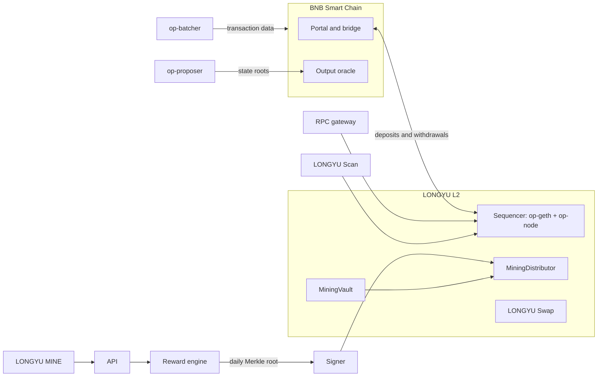

<p align="center">
  <picture>
    <source media="(prefers-color-scheme: dark)" srcset="brand/logo/lockup-white.svg">
    
  </picture>
</p>

# LONGYU Network

[](https://github.com/Longyu-L2/LongyuL2/actions/workflows/ci.yml)

LONGYU is a Layer 2 network that settles on BNB Smart Chain. Gas is paid in BNB and blocks arrive every 250 ms.

This repository is the whole network in one place: the chain configuration, the mining contracts, the reward engine, the backend, the block explorer, the bridge and swap pages, and LONGYU MINE, the app people mine with.

The network is on public testnet. The contracts have not had an external audit yet. See [SECURITY.md](SECURITY.md).

## Testnet

| | |
|---|---|
| Website | https://longyu.network |
| Chain ID | `668801` |
| Settles on | BSC testnet (chain 97) |
| Gas token | BNB, bridged from BSC testnet and shown as tBNB |
| RPC | https://rpc-testnet.longyu.network |
| Explorer | https://scan-testnet.longyu.network |
| Bridge | https://testnet.longyu.network/bridge.html |
| Swap | https://testnet.longyu.network/swap.html |
| LONGYU MINE | https://mine-testnet.longyu.network |
| Developers | https://longyu.network/developers |

Contracts on LONGYU testnet:

| Contract | Address |
|---|---|
| tLONG (bridged BEP-20) | `0xF4769160D6dc78F66f61F0eA1638E65d43610163` |
| MiningDistributor | `0x096ca64cB06f555c56F67FD618684D5C2b7F9e06` |
| MiningVault | `0x5c8630c2210943aF91F01774cC1CafdAf61ff097` |
| EmissionSchedule | `0x6F11804A7993895b112A99caf774b37cEd49E096` |
| Faucet | `0x4C48f21885eE29a9682D0bf37b0c6af544dFEE51` |
| Swap router | `0xed3Eb7fe322424C14cc356Ab182021cAb8dCf01A` |
| Swap factory | `0xfE5372cA129113bf12EC70D1EE4A7cBB14f172B0` |

Contracts on BSC testnet:

| Contract | Address |
|---|---|
| tLONG | `0x88d5B1946BaB654e31Fbf0bcc3D022e995aB129C` |
| OptimismPortal (proxy) | `0xB1ba2E8af7137c607987F1c8d89c0f8b0c7D2623` |
| L1StandardBridge (proxy) | `0xbd5585161c5E9797D2102e775D9C5439aB51279a` |
| L2OutputOracle (proxy) | `0x2dC53f20F511Bf079167Ef013d6107787E620fE3` |

The full list of rollup contracts is in [chain/testnet/l1-deployments.json](chain/testnet/l1-deployments.json).

## How it fits together



**Chain.** LONGYU runs the rollup stack BNB Chain publishes for L2s on BSC ([bnb-chain/opbnb](https://github.com/bnb-chain/opbnb), an OP Stack fork), with its own chain ID, sequencer and bridge contracts. Transaction data and state roots are posted to BSC. Withdrawals to BSC take seven days.

**Mining.** A session in the app lasts 24 hours and counts for the UTC day it starts in. After each day closes, the reward engine computes every account's reward from the published rules, builds a Merkle tree of cumulative entitlements and posts its root on chain. The root waits out a challenge delay, during which a guardian can veto it, and then pays claims. The vault releases tokens to the distributor only as they become claimable, and never more than the emission schedule allows. The exact rules are in [docs/MINING_SPEC.md](docs/MINING_SPEC.md).

**Keys.** The API holds no signing keys. A separate service with no public address signs the daily root, relayed claims and faucet vouchers, and refuses anything else. Users' wallet keys are created and kept on their own device.

## Repository layout

| Path | Contents |
|---|---|
| [contracts/](contracts/) | Mining contracts, faucet, payment router, token (Foundry) |
| [contracts/dex/](contracts/dex/) | LONGYU Swap, a Uniswap V2 fork with two documented patches |
| [packages/reward-engine/](packages/reward-engine/) | Daily settlement and Merkle roots, in integer maths that matches the contracts |
| [packages/abis/](packages/abis/) | Contract ABIs as TypeScript |
| [apps/api/](apps/api/) | Backend: sessions, settlement, publishing, claims, faucet, admin console |
| [apps/signer/](apps/signer/) | The signing service |
| [apps/explorer/](apps/explorer/) | LONGYU Scan: indexer, pages and JSON API in one service |
| [apps/web/](apps/web/) | Bridge, swap and claim pages |
| [apps/mobile/](apps/mobile/) | LONGYU MINE for Android and browsers (Expo, React Native) |
| [chain/](chain/) | Genesis, rollup config, node images and the public RPC gateway |
| [ops/](ops/) | Contract monitoring |
| [brand/](brand/) | Logo, colours and icons, built from one tokens file |
| [docs/](docs/) | Mining specification and API reference |

## Running it

Requirements: Node 22 or later, and [Foundry](https://book.getfoundry.sh/getting-started/installation).

```sh
npm install

# Contracts
cd contracts
forge install --no-git foundry-rs/forge-std@v1.17.0
forge install --no-git OpenZeppelin/openzeppelin-contracts@v5.6.1
forge test
cd ..

# Services
npm run typecheck
npm test -w @longyu/reward-engine
npm test -w @longyu/api
npm run test:e2e -w @longyu/api        # backend against real contracts on Anvil
npm test -w @longyu/explorer
npm test -w @longyu/web
npm run test:rpc
```

A local stack, with Anvil standing in for the chain:

```sh
cd apps/api
npm run devnet                          # starts Anvil, deploys the contracts, writes .env.devnet
node --env-file=.env.devnet --import tsx src/server.ts
```

The app:

```sh
cd apps/mobile
npm install --legacy-peer-deps
EXPO_PUBLIC_API_URL=http://localhost:8080 EXPO_PUBLIC_DEV_ATTESTATION=true npx expo start
```

## Adding the network to a wallet

| Field | Value |
|---|---|
| Network name | LONGYU Testnet |
| RPC URL | https://rpc-testnet.longyu.network |
| Chain ID | 668801 |
| Currency symbol | tBNB |
| Block explorer | https://scan-testnet.longyu.network |

Testnet BNB reaches LONGYU through the [bridge](https://testnet.longyu.network/bridge.html) from BSC testnet.

## Building on LONGYU

LONGYU is EVM equivalent, so Foundry, Hardhat and viem work as they do on any EVM chain. Compile for the `cancun` EVM version. The [developer page](https://longyu.network/developers) has the settings, the commands and the addresses of the contracts already on the chain (Multicall3, Permit2, the CREATE2 deployer, the ERC-4337 EntryPoint v0.6, Safe), ready to copy.

A contract's source is published on its explorer page once the explorer has compiled it and found the same code at the address. With Foundry:

```sh
forge verify-contract <address> src/Token.sol:Token \
  --chain-id 668801 \
  --verifier blockscout \
  --verifier-url https://scan-testnet.longyu.network/api \
  --watch
```

With Hardhat 3 and `@nomicfoundation/hardhat-verify`, describe the chain in `hardhat.config.ts` and run `npx hardhat verify --network longyu <address>`:

```ts
chainDescriptors: {
  668801: {
    name: "LONGYU Testnet",
    blockExplorers: {
      etherscan: {
        name: "LONGYU Scan",
        url: "https://scan-testnet.longyu.network",
        apiUrl: "https://scan-testnet.longyu.network/api",
      },
    },
  },
},
verify: {
  etherscan: { apiKey: "none" },
  blockscout: { enabled: false },
  sourcify: { enabled: false },
},
```

With Hardhat 2, the same explorer goes in `etherscan.customChains`, and `apiKey` has to be an object keyed by network name:

```ts
etherscan: {
  apiKey: { longyu: "none" },
  customChains: [
    {
      network: "longyu",
      chainId: 668801,
      urls: {
        apiURL: "https://scan-testnet.longyu.network/api",
        browserURL: "https://scan-testnet.longyu.network",
      },
    },
  ],
},
sourcify: { enabled: false },
```

The explorer needs no API key. There is also a form at https://scan-testnet.longyu.network/verify. How verification is kept safe is in [apps/explorer/README.md](apps/explorer/README.md).

## Security

Report vulnerabilities privately, as described in [SECURITY.md](SECURITY.md).

What is tested today: the contracts have unit, fuzz and invariant suites; roots built by the TypeScript engine are claimed leaf by leaf against the real contract; the backend runs end to end against the contracts on a local chain. What is not done: an external audit, which comes before mainnet.

## Contributing

See [CONTRIBUTING.md](CONTRIBUTING.md) for how to set up, test and send a change.

## Licence

MIT, except `contracts/dex`, which is GPL-3.0-or-later like the Uniswap V2 code it derives from. See [LICENSE](LICENSE).
